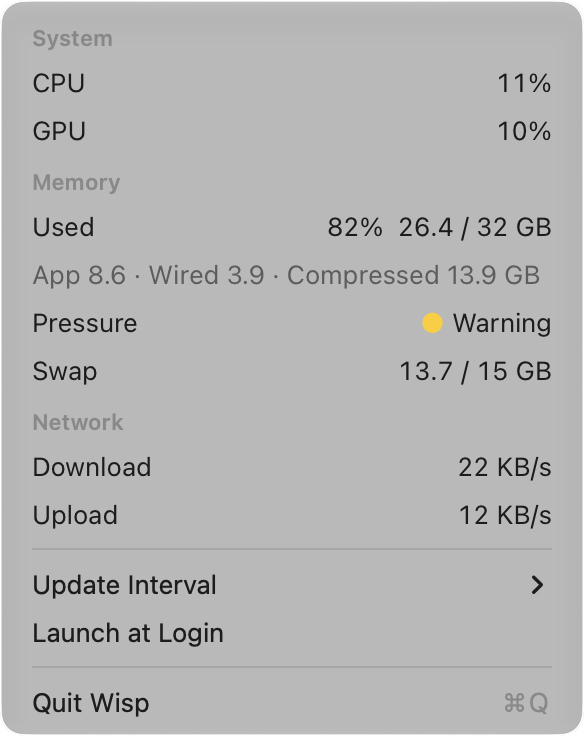

# Wisp

A macOS menu bar resource monitor that costs almost nothing to run.

Stats and iStat Menus show the right numbers, but they cost 1–11% CPU and tens of MB, and most of that goes into graphs and redraws you never look at. Wisp shows CPU, GPU and memory in one small item, a plain list when you click it, and nothing else.

<p>
  <picture>
    <source media="(prefers-color-scheme: dark)" srcset="docs/images/item-dark.png">
    
  </picture>
</p>

<p>
  <picture>
    <source media="(prefers-color-scheme: dark)" srcset="docs/images/dropdown-dark.png">
    
  </picture>
</p>

## What it is

- **Menu bar:** CPU %, GPU % and memory % as three small columns, a constant ~130 pt wide so it never pushes its neighbours around.
- **Dropdown:** CPU and GPU, memory used with the app / wired / compressed breakdown, memory pressure, swap, and network download and upload. The rows update live while it is open.
- **Settings:** update interval (1, 2, 3, 5 or 10 s, default 2 s) and Launch at Login, both in the dropdown. There is no preferences window.
- Also, sampling stops while the display sleeps, the Mac sleeps or the screen is locked, and starts again on a fresh baseline.

## What it is not

No graphs, sparklines or history, no per-process lists, no notifications, no popover or preferences windows, no themes. No Intel Macs, no auto-update, no App Store. Temperatures and power are left for a later version, because they need private macOS interfaces that break between OS and chip versions.

## What it costs

Measured against Stats set up to show the same things (CPU, GPU and RAM modules, `mini` widgets, 2 s interval), both apps over the same 10 minute window with their menus closed, on an Apple M5 with 32 GB, macOS 27.0.1, two displays. The method and every run, raw output included, are in [`docs/benchmarks/`](docs/benchmarks/METHOD.md).

Across every Method v1 run so far, Wisp uses **0.038–0.093% CPU and 13.9–14.6 MiB**, Stats 1.99–2.23% and 120–137 MiB. That is 22–59× less CPU and 8.7–9.5× less memory.

| Run | Wisp | Stats | Stats ÷ Wisp |
|---|---|---|---|
| [normal use](docs/benchmarks/runs/2026-10-18-e29c4c7.md), Stats 3.0.22 | 0.093% CPU, 13.9 MiB | 2.040%, 120.5 MiB | 22× CPU, 8.7× memory |
| [idle](docs/benchmarks/runs/2026-10-18-7d7bf25.md), Stats 3.0.21 | 0.085% CPU, 14.4 MiB | 1.988%, 137.0 MiB | 23×, 9.5× |
| [activity not observed](docs/benchmarks/runs/2026-10-18-acee20c.md), Stats 3.0.21 | 0.038% CPU, 14.6 MiB | 2.225%, 137.0 MiB | 59×, 9.4× |

CPU at these levels moves by about ±20% between runs of the same build, so the claim is the range, not the best run. The oldest run predates the refresh of the item's copy on a second display, which costs about 0.05% (one ~14 ms button render every 30 s), so the two newer ones are the fair figure for today's build.

### The dropdown

The first time a process opens an `NSMenu`, AppKit keeps 4.5–7.3 MiB for the life of that process, and nothing gives it back. So Wisp itself never opens one. A click starts the same binary as a short-lived helper (`wisp --dropdown`), which shows the menu and exits when it closes, taking that memory with it ([ADR 0001](docs/adr/0001-dropdown-in-helper-process.md)).

It opens in 130–151 ms (median 138.5 ms), about half of that the process start. The helper peaks at ~18 MiB while the menu is up, and the main process stays where it was: +16 and +32 KiB after five opens ([record](docs/benchmarks/runs/2026-10-18-fafc024-dropdown.md)).

## Build from source

Needs macOS 14 or later on Apple Silicon, and a Rust toolchain (1.85+).

```sh
git clone https://github.com/saddathasan/wisp
cd wisp
scripts/bundle.sh       # release build, wrapped and ad-hoc signed as target/Wisp.app
open target/Wisp.app
```

There is no Dock icon. Quit from the dropdown (Quit Wisp, ⌘Q).

## Launch at Login

Turn it on from the dropdown. macOS shows a "Background Items Added" notification, and Wisp then appears in System Settings → General → Login Items. It only works from the bundled `Wisp.app`, not from `cargo run`.

Rebuilding in place with `scripts/bundle.sh` keeps it on, nothing needs re-enabling: macOS keys the login item on the bundle id and the app's path, not the signature. A copy at another path (say `/Applications`) should be a separate login item by the same logic, I haven't tested that one yet, so turn it on from the copy you actually run. Details are in [launch-at-login.md](docs/research/launch-at-login.md).

## Licence

[MIT](LICENSE)
